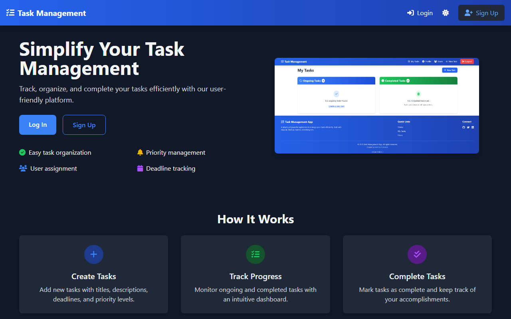

# Task Management App

A full-stack task manager with organizations, roles and task assignment, built with Angular, Express and MongoDB.

**Live demo:** https://task-management-app-manthanank.vercel.app/



The app supports organization-based multi-tenancy, role-based access control (user/admin/super), task assignment and tracking, optional Gemini-powered task helpers, and a responsive Tailwind CSS interface.

## Table of Contents

- [Features](#features)
- [Technologies Used](#technologies-used)
- [Prerequisites](#prerequisites)
- [Run locally](#run-locally)
- [Installation](#installation)
- [Running the Application](#running-the-application)
- [API Endpoints](#api-endpoints)
- [Usage](#usage)
- [License](#license)

## Features

- User authentication with JWT (register, login, auto-logout)
- Organization-based multi-tenancy with member management
- Role-based access control: user, admin, super
- Task CRUD with assignment to organization members
- Task filtering by status, priority, and search
- Subtask/checklist support
- Activity log per task
- Dashboard with task statistics
- Password reset by email (SMTP)
- Gemini helpers: suggest subtasks, improve descriptions, suggest priority, summarize tasks, and an assistant chat
- Light and dark themes
- Swagger API docs at `/api-docs`
- Responsive design using Tailwind CSS

## Technologies Used

- **Backend**: Node.js, Express.js, MongoDB, Mongoose, JWT, bcryptjs, Helmet, express-rate-limit, Swagger
- **AI**: Google Gemini (`@google/genai`)
- **Frontend**: Angular 19, Tailwind CSS, RxJS
- **Authentication**: JSON Web Tokens (JWT)

## Prerequisites

- Node.js (v18.x or later)
- Angular CLI (v19.x or later)
- MongoDB (local or Atlas instance)

## Run locally

```sh
git clone https://github.com/manthanank/task-management-app.git
cd task-management-app

# API (needs MongoDB; copy backend/.env.example to backend/.env and fill it in)
cd backend
npm install
npm start

# Frontend, in a second terminal from the repo root
npm install
npm start
```

Open http://localhost:4200. The frontend talks to the API at http://localhost:3000/api when running on localhost. `GEMINI_API_KEY` and the SMTP settings are only needed for the AI helpers and password reset emails.

## Installation

### Backend

1. Clone the repository:

    ```sh
    git clone https://github.com/manthanank/task-management-app.git
    cd task-management-app/backend
    ```

2. Install dependencies:

    ```sh
    npm install
    ```

3. Create a `.env` file in the `backend` directory. `.env.example` lists every variable, including the optional SMTP and Gemini settings:

    ```bash
    PORT=3000
    MONGODB_USER=your_mongodb_user
    MONGODB_PASSWORD=your_mongodb_password
    MONGODB_DBNAME=tasksdb
    MONGODB_HOST=cluster0.example.mongodb.net
    JWT_SECRET=your_strong_random_secret
    CORS_ORIGIN=http://localhost:4200
    ```

4. Start the backend server:

    ```sh
    npm start
    ```

### Frontend

1. Navigate to the project root:

    ```sh
    cd task-management-app
    ```

2. Install dependencies:

    ```sh
    npm install
    ```

3. Start the frontend development server:

    ```sh
    ng serve
    ```

## Running the Application

- The backend server runs on `http://localhost:3000`
- The frontend server runs on `http://localhost:4200`
- API documentation is available at `http://localhost:3000/api-docs`

## API Endpoints

### Auth

- **POST /api/auth/register** — Register a new user (optionally with organization)
- **POST /api/auth/login** — Login and receive JWT token
- **POST /api/auth/logout** — Logout
- **GET /api/auth/users** — Get all users (authenticated)

### Tasks

- **GET /api/tasks** — Get all tasks (organization-scoped)
- **GET /api/tasks/ongoing** — Get ongoing tasks (with search, filter, sort)
- **GET /api/tasks/completed** — Get completed tasks
- **GET /api/tasks/user** — Get current user's tasks
- **GET /api/tasks/summary/stats** — Get task statistics
- **GET /api/tasks/:id** — Get task by ID
- **GET /api/tasks/:id/activities** — Get task activity log
- **POST /api/tasks** — Create a new task (admin)
- **PUT /api/tasks/:id** — Update a task
- **DELETE /api/tasks/:id** — Delete a task

### Users

- **GET /api/users** — Get all users (paginated)
- **GET /api/users/organization** — Get users in same organization
- **GET /api/users/profile** — Get current user's profile
- **GET /api/users/:id** — Get user by ID
- **PUT /api/users/:id** — Update user
- **DELETE /api/users/:id** — Delete user (admin)

### Organizations

- **GET /api/organizations** — Get all organizations (admin)
- **GET /api/organizations/my** — Get current user's organization
- **GET /api/organizations/:id** — Get organization by ID
- **POST /api/organizations** — Create organization (admin)
- **PUT /api/organizations/:id** — Update organization (admin)
- **DELETE /api/organizations/:id** — Delete organization (owner)
- **GET /api/organizations/:id/members** — Get organization members
- **POST /api/organizations/:id/members** — Add member (admin)
- **DELETE /api/organizations/:id/members** — Remove member (admin)

## Usage

1. **Register** — Create a new account, optionally creating or joining an organization.
2. **Log In** — Authenticate to access the task management features.
3. **Dashboard** — View task statistics for your organization.
4. **Tasks** — Create, view, edit, delete, and filter tasks. Assign tasks to organization members.
5. **Organizations** — Manage organization members (admin/super roles).
6. **Profile** — View your profile and organization role.

## License

This project is licensed under the MIT License. See the [LICENSE](LICENSE) file for details.
